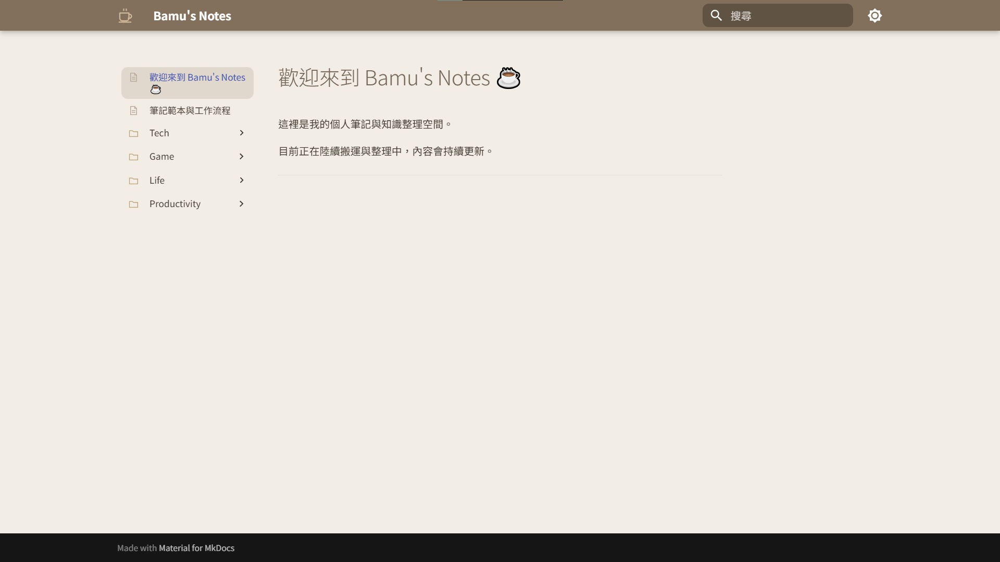
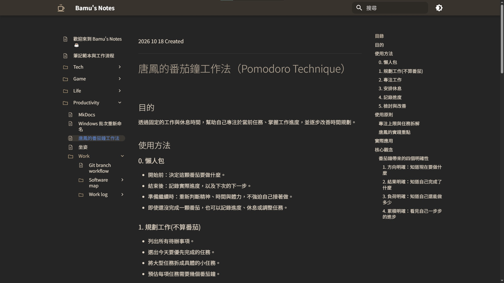

# Shared Notes｜個人筆記網站



使用 **MkDocs + Material for MkDocs** 建立的個人筆記網站，用來整理程式開發、技術研究與日常學習紀錄。

網站以現成的 Material 主題為基礎，主要自行客製化 CSS 外觀與整理 Markdown 文件，並非從零開發網站框架。

## 網站連結

[Live Demo](https://a892842486.github.io/shared-notes/)

## 使用技術

- **MkDocs**：靜態網站產生器
- **Material for MkDocs**：網站主題、導覽與搜尋功能
- **Markdown**：筆記撰寫與內容管理
- **CSS**：自訂配色、圖示與介面樣式
- **GitHub Pages**：網站部署

## 客製化內容

- 暖咖啡色系的日間與夜間模式
- 自訂導覽列圖示、Hover 動畫
- 調整 Navbar 排版、圓角與搜尋框樣式
- 依主題分類技術筆記與生活紀錄

## 專案架構

```text
shared-notes/
├── mkdocs.yml          # MkDocs 設定
├── public/             # 公開筆記
│   ├── Tech/           # 技術筆記
│   ├── productivity/   # 生產力與工作紀錄
│   ├── life/           # 生活筆記
│   ├── game/           # 遊戲筆記
│   ├── images/         # 圖片資源
│   └── stylesheets/    # 自訂 CSS
├── private/            # 不納入網站建置的筆記
└── README.md
```

## 網站截圖

