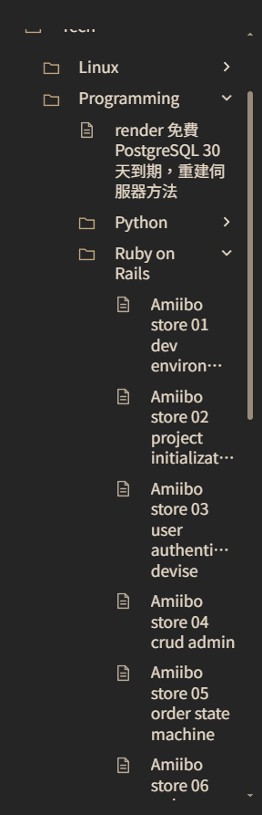

2026 11 09 Created

---

# 代辦、思考 (隨時更新)

## 人生規劃

1. 七天內 (11/12 開始計算)，若繼續身心不寧，就直接找半導體，可找老哥討論
2. 每天保底一個番茄，鍛鍊 "啟動" 的能力，找回生活節奏
3. 重訓內容砍半、洗澡routine 一天一次改兩三天一次，保留體力、意志力
4. 不設定就寢時間，著重醒著的時候人生有意義（放鬆/番茄 都有意義）
5. 白天坐不下就直接重訓或外出（補洗衣精/買豆漿之類的都好）

## 工作番茄

1. 快速交付作品五

更新 Bamu Portfolio 的 seed，更新 github render
更新 104 履歷

2. 恢復每日 104 投三間，投了就當沒聲音繼續交付作品
可一次儲存兩周的公司量，方便每日投遞

## 放鬆番茄

1. 繼續分類整理硬碟
2. 整理 CDEF槽內的資料排序（變整齊）
3. 整理 chrome 書籤
4. vscode 必裝插件或環境配置?
5. 搬運保存 code discord 的 "原始檔案" (即使有 cook 新筆記，但 discord 原版格式依然要保存)
6. 解決 MkDocs 標題擠成一堆的樣子 還有 內文太窄

7. 問題 是否 tailwind 都那麼長那麼多重複那麼複雜呢?
難道不能像 mkdocs 一口氣改全部版面嗎?
只針對想 "突出" 的個案使用獨立的 tailwind，其餘皆用通用守則，寫起來代碼應該會乾淨很多吧?
8. 用不同頻道 自己剪自己喜歡的音樂 bgm 取名英文 附上音源來源之類的? 問GPT非營利這樣OK嗎? 若開營利呢? 主要是自用，順便分享給其他人
9. 甚麼是女性主義?

## Nice To Have

作品四先完成這個版本。未來如果想讓親朋好友也能輕鬆使用，再考慮：
- 將 Python、yt-dlp、FFmpeg 打包成可執行程式。
- 製作一個安裝器，自動完成 Native Host 註冊。
- 讓使用者只需要安裝擴充功能與執行一次安裝程式。