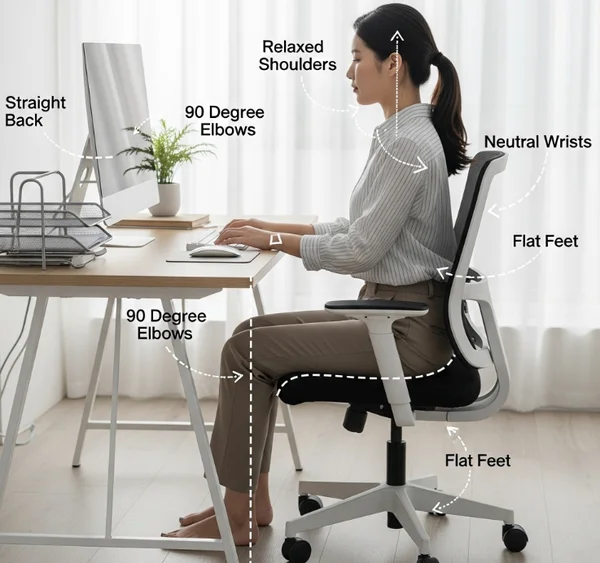

2026 11 01 Created

---

# 電腦坐姿高度調整

## 坐姿原則
1. 肩膀：打字時自然放鬆，不聳肩。
2. 雙腳：腳掌有支撐，膝蓋約 90～110 度。
3. 手腕：保持自然，不上折、不持續受壓。
4. 螢幕：視線平視螢幕上緣附近，看中心時稍微向下；螢幕可略微上仰（約 0～5 度），以觀看舒適、無反光為主。
5. 測試：打字 20～30 分鐘，依肩頸、腰背、手腕舒適度調整。

## 桌椅高度調整

### 狀況一、桌椅皆無法升降
1. 調整鍵盤位置，避免聳肩。
2. 腳掌無法貼地：使用室內拖鞋、小凳、IKEA 擱腳凳（NT$399）。

### 狀況二、只有椅子可升降
1. 調高椅子，直到打字不需聳肩。
2. 腳掌無法貼地，再增加腳部支撐。

### 狀況三、桌椅皆可升降
1. 椅子：雙腳能穩定踩地。
2. 桌子：打字不需聳肩。

## 鍵盤滑鼠

> 兩種方式可依舒適度切換，避免長時間維持固定姿勢、定期活動休息。
> 用小毛巾、襪子墊在接觸位置，減少局部壓力。

### 方式一：前臂懸空

1. 鍵盤深度：離桌緣約 5cm
2. 肩膀自然垂下、上臂靠近身體兩側、手肘自然彎曲、前臂自然懸空
3. 注意：休息時放下手臂。

### 方式二：前臂支撐

1. 鍵盤深度：適度往桌內推，讓部分前臂輕靠桌面，不過度伸手。
2. 前臂：輕靠桌面，分散重量。
3. 掌根：不刻意懸空 (通常會稍微懸空)，避免持續受壓。
4. 手肘：自然懸空。

 

### 滑鼠!
1. 放在自然伸手可及的位置，保留移動空間。
2. 避免手臂過度外展、手腕長時間彎曲。

## 來源

- **方式一｜CCOHS**：加拿大職業安全衛生中心  
  [鍵盤人體工學指南](https://www.ccohs.ca/oshanswers/ergonomics/office/keyboard.html)
- **方式二｜OSHA**：美國職業安全衛生署  
  [鍵盤人體工學指南](https://www.osha.gov/etools/computer-workstations/components/keyboards)

> 兩種方式是依官方人體工學原則整理，並非官方指定姿勢，也不互斥。

**核心：肩膀放鬆、手腕自然、避免壓迫、適度變換姿勢。**